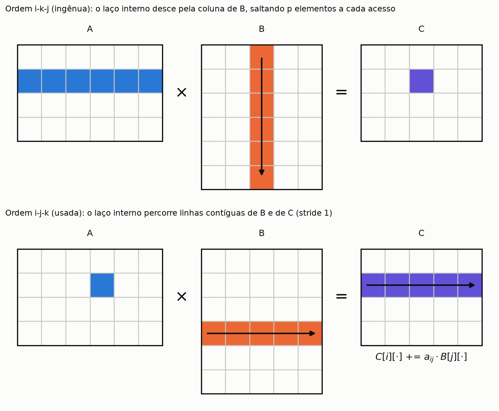

# Multiplicação de Matrizes Paralela

Trabalho final de **Programação Paralela e Distribuída (2026/2) — UFSCar**. Comparamos a multiplicação de matrizes da Maratona de Programação Paralela (SBAC-PAD) em quatro versões: sequencial, OpenMP, MPI e CUDA.

**Integrantes**
- Enzo Dezem Alves — 801743
- Gustavo Cesar Bento Laurindo — 821402
- Gustavo de Oliveira Gimenes — 820759
- Tiago de Paula Evangelista — 824369

## O problema


Multiplicar uma matriz $A$ de dimensão $n \times m$ por uma matriz $B$ de dimensão $m \times p$ gera uma matriz $C$ de dimensão $n \times p$. Cada elemento é calculado por

$$c_{ik} = \sum_j a_{ij} \, b_{jk}$$

ou seja, a linha $i$ de $A$ (azul) é combinada com a coluna $k$ de $B$ (laranja) para gerar o elemento $c_{ik}$ (violeta). São $2nmp$ operações no total. Como nenhum elemento de $C$ depende de outro, todos podem ser calculados ao mesmo tempo, e é isso que as versões paralelas vão explorar.

## Implementação sequencial



A versão sequencial é a referência de tempo e de correção para todas as outras. A fórmula pode ser calculada com os laços em ordens diferentes, e a ordem muda muito o desempenho:

- **`i-k-j` (ingênua):** calcula cada $c_{ik}$ de uma vez, mas para isso desce pela coluna de $B$. Como as matrizes ficam guardadas linha por linha, cada acesso salta $p$ posições na memória e desperdiça o cache.
- **`i-j-k` (usada):** fixa um valor $a_{ij}$ e o multiplica pela linha inteira $B[j]$, acumulando na linha $C[i]$. As duas linhas estão contíguas na memória, o que aproveita o cache e permite que o compilador vetorize o laço.

As duas ordens fazem as mesmas contas. A versão `i-j-k` é a referência para as medições.

## Medição de tempo padronizada

Todas as implementações usam matrizes contíguas por linhas, com entradas determinísticas em precisão dupla.

- [`src/common.h`](src/common.h) define a leitura das dimensões, a inicialização e o *checksum*. Com `MATMUL_VERIFY=1`, um produto escalar de referência também confere cada elemento de $C$.
- Execute `./prog n m p` para $A_{n\times m}B_{m\times p}$ ou `./prog n` para matrizes quadradas. A linha `RESULT,<impl>,<n>,<m>,<p>,<workers>,<tempo_s>,<checksum>` é a saída comum.
- O tempo principal inclui o custo da região paralela do OpenMP, as coletivas do MPI e as cópias host ↔ GPU em CUDA. A alocação, a preparação das entradas, a inicialização da plataforma e a validação ficam fora da janela cronometrada.
- `DETAIL,mpi,<nós>,<scatter_s>,<bcast_s>,<compute_max_s>,<gather_s>` registra o tempo do rank 0 nas coletivas e o maior tempo de cálculo entre ranks. `DETAIL,cuda,<h2d_s>,<kernel_s>,<d2h_s>` registra as cópias e o tempo do kernel.

## Notebook

Abra [`matrix_multiplication.ipynb`](matrix_multiplication.ipynb) no Google Colab. O notebook inclui os fontes e compila em um diretório temporário. Para CUDA, selecione uma GPU em **Ambiente de execução → Alterar tipo de ambiente de execução**. Execute as células em ordem. As medições locais são exportadas em `matmul-local.csv`. O arquivo [`results/local-wsl.csv`](results/local-wsl.csv) registra as medições em WSL2 com GCC 15.2, Open MPI 5.0.10 e um nó.

Em Linux ou WSL2, instale GCC com OpenMP, Open MPI (`mpicc` e `mpirun`) e, para CUDA, o CUDA Toolkit com `nvcc`. Use Jupyter para executar o mesmo notebook.

```bash
python3 -m venv venv
source venv/bin/activate
pip install -r requirements.txt
jupyter lab matrix_multiplication.ipynb
```

## Compilar e executar no terminal

```bash
mkdir -p src/bin
gcc -O3 src/sequential.c -o src/bin/sequential
gcc -O3 -fopenmp src/openmp.c -o src/bin/openmp
mpicc -O3 src/mpi.c -o src/bin/mpi

MATMUL_VERIFY=1 ./src/bin/sequential 17 23 31
MATMUL_VERIFY=1 OMP_NUM_THREADS=4 OMP_SCHEDULE=static ./src/bin/openmp 17 23 31
MATMUL_VERIFY=1 mpirun -np 4 ./src/bin/mpi 17 23 31
```

Em Linux ou WSL2 com GPU NVIDIA e Toolkit CUDA 11.8 ou posterior, use `-arch=native` para a GPU disponível. A RTX 4050 Laptop e a RTX 4060 usam arquitetura Ada (`sm_89`). Para WSL2, instale o driver NVIDIA no Windows e siga a [configuração do CUDA no WSL](https://docs.nvidia.com/cuda/wsl-user-guide/index.html).

```bash
nvidia-smi
nvcc -O3 -arch=native src/cuda.cu -o src/bin/cuda
MATMUL_VERIFY=1 ./src/bin/cuda 17 23 31
```

## Executar MPI no OpenHPC da UFSCar

No nó de acesso do cluster, entre na raiz da cópia atualizada do repositório. Carregue os módulos indicados pela disciplina para GCC e MPI e confirme `mpicc -show`. O script usa Slurm. Consulte `srun --mpi=list` e selecione o tipo de integração disponível no cluster, por exemplo `MPI_TYPE=pmix` para um Open MPI com PMIx. Use as opções de conta e partição da disciplina em `sbatch`, quando exigidas.

```bash
# 8 ranks em 1 nó, com uma varredura adicional em 1, 2 e 4 ranks
MPI_TYPE=pmix sbatch --nodes=1 --ntasks=8 --ntasks-per-node=8 scripts/openhpc.sbatch

# Os mesmos 8 ranks, agora distribuídos em 2 nós
MPI_TYPE=pmix sbatch --nodes=2 --ntasks=8 --ntasks-per-node=4 scripts/openhpc.sbatch
```

Cada job valida um caso retangular e mede cinco repetições por combinação para as ordens 256, 512, 1024 e 2048. Passe outras ordens após o nome do script ou exporte `REPS` para mudar o número de repetições. A referência sequencial roda dentro da mesma alocação. O MPI informa quantos nós usou, e o script encerra com erro se a colocação divergir da alocação solicitada.

Após a conclusão, transfira os logs `matmul-openhpc-<job>.log` para o diretório do notebook ou envie pela aba **Arquivos** do Colab. Execute as células da seção de análise para ver tempo, desvio padrão, *speedup*, eficiência e o peso das coletivas. A comparação de um e dois nós mantém o total de ranks e o tamanho das matrizes. Entregue os logs com o notebook para comprovar os jobs do cluster.
