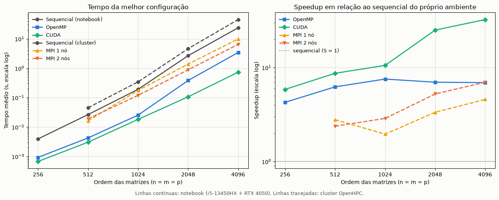

# Multiplicação de Matrizes Paralela

Trabalho final de **Programação Paralela e Distribuída (2026/2) — UFSCar**. Comparamos a multiplicação de matrizes da Maratona de Programação Paralela (SBAC-PAD) em quatro versões: sequencial, OpenMP, MPI e CUDA.

**Integrantes**
- Enzo Dezem Alves — 801743
- Gustavo Cesar Bento Laurindo — 821402
- Gustavo de Oliveira Gimenes — 820759
- Tiago de Paula Evangelista — 824369

## O problema


Multiplicar uma matriz $A$ de dimensão $n \times m$ por uma matriz $B$ de dimensão $m \times p$ gera uma matriz $C$ de dimensão $n \times p$. Cada elemento é calculado por

$$c_{ik} = \sum_j a_{ij} \, b_{jk}$$

ou seja, a linha $i$ de $A$ (azul) é combinada com a coluna $k$ de $B$ (laranja) para gerar o elemento $c_{ik}$ (violeta). São $2nmp$ operações no total. Como nenhum elemento de $C$ depende de outro, todos podem ser calculados ao mesmo tempo, e é isso que as versões paralelas vão explorar.

## Implementação sequencial


A versão sequencial é a referência de tempo e de correção para todas as outras. A fórmula pode ser calculada com os laços em ordens diferentes, e a ordem muda muito o desempenho:

- **`i-k-j` (ingênua):** calcula cada $c_{ik}$ de uma vez, mas para isso desce pela coluna de $B$. Como as matrizes ficam guardadas linha por linha, cada acesso salta $p$ posições na memória e desperdiça o cache.
- **`i-j-k` (usada):** fixa um valor $a_{ij}$ e o multiplica pela linha inteira $B[j]$, acumulando na linha $C[i]$. As duas linhas estão contíguas na memória, o que aproveita o cache e permite que o compilador vetorize o laço.

As duas ordens fazem as mesmas contas. A versão `i-j-k` é a referência para as medições. O laço fica na função `matmul_rows` de [`src/common.h`](src/common.h), usada pelas versões sequencial, OpenMP e MPI, para que o compilador gere o mesmo código nas três e o *speedup* meça apenas o efeito da paralelização. A função é marcada com `__attribute__((noipa))`: sem isso, o GCC 9.4 do cluster a otimizava de um jeito diferente em cada programa, e o MPI com um rank ficava 33% mais lento que a versão sequencial.

## Medição de tempo padronizada

Todas as implementações usam matrizes contíguas por linhas, com entradas determinísticas em precisão dupla.

- [`src/common.h`](src/common.h) define a leitura das dimensões, a inicialização e o *checksum*. Com `MATMUL_VERIFY=1`, um produto escalar de referência também confere cada elemento de $C$.
- Execute `./prog n m p` para $A_{n\times m}B_{m\times p}$ ou `./prog n` para matrizes quadradas. A linha `RESULT,<impl>,<n>,<m>,<p>,<workers>,<tempo_s>,<checksum>` é a saída comum.
- O tempo principal inclui o custo da região paralela do OpenMP, as coletivas do MPI e as cópias host ↔ GPU em CUDA. A alocação, a preparação das entradas, a inicialização da plataforma e a validação ficam fora da janela cronometrada.
- `DETAIL,mpi,<nós>,<scatter_s>,<bcast_s>,<compute_max_s>,<gather_s>` registra o tempo do rank 0 nas coletivas e o maior tempo de cálculo entre ranks. `DETAIL,cuda,<h2d_s>,<kernel_s>,<d2h_s>` registra as cópias e o tempo do kernel.

## Notebook

Abra [`matrix_multiplication.ipynb`](matrix_multiplication.ipynb) no Google Colab. O notebook inclui os fontes e compila em um diretório temporário. Para CUDA, selecione uma GPU em **Ambiente de execução → Alterar tipo de ambiente de execução**. Execute as células em ordem. As medições locais são exportadas em `matmul-local.csv`.

Resultados guardados em [`results/`](results/):

- [`local-i5-13450HX-rtx4050.csv`](results/local-i5-13450HX-rtx4050.csv): execução local que aparece no notebook entregue (sequencial, OpenMP e CUDA), com Intel Core i5-13450HX (16 threads), GPU RTX 4050 Laptop, GCC 13 e CUDA 12.0, para as ordens 256 a 4096;
- [`openhpc/saida-1152732.out`](results/openhpc/saida-1152732.out): saída do job MPI no cluster OpenHPC (2 máquinas com Xeon E5-2650 v3, 8 processos em cada, ordens 512 a 4096, 3 repetições), lida pelo notebook;
- [`local-wsl.csv`](results/local-wsl.csv): execução anterior em WSL2 (Intel Core i5-14600K, GCC 15.2, Open MPI 5.0.10), sem GPU e com o laço OpenMP antigo, mantida apenas como registro.

Em Linux ou WSL2, instale GCC com OpenMP, Open MPI (`mpicc` e `mpirun`) e, para CUDA, o CUDA Toolkit com `nvcc`. Use Jupyter para executar o mesmo notebook.

```bash
python3 -m venv venv
source venv/bin/activate
pip install -r requirements.txt
jupyter lab matrix_multiplication.ipynb
```

## Resultados

Melhor tempo médio de cada implementação com $n = m = p = 4096$, em precisão dupla. Sequencial, OpenMP e CUDA rodaram no notebook (i5-13450HX + RTX 4050 Laptop, 5 repetições); o MPI rodou no cluster OpenHPC (Xeon E5-2650 v3, 3 repetições). Cada *speedup* é calculado em relação à versão sequencial do mesmo ambiente.

| Ambiente | Implementação | Melhor configuração | Tempo | *Speedup* |
|---|---|---|---:|---:|
| Notebook | Sequencial | 1 thread | 23,69 s | 1,0× |
| Notebook | OpenMP | `dynamic,8`, 16 threads | 3,43 s | 6,9× |
| Notebook | CUDA | *tiles* 16×16, com cópias | 0,73 s | 32,4× |
| Cluster | Sequencial | 1 processo | 45,10 s | 1,0× |
| Cluster | MPI | 8 ranks, 1 máquina | 9,85 s | 4,6× |
| Cluster | MPI | 16 ranks, 2 máquinas | 6,46 s | 7,0× |

O gráfico mostra a melhor configuração de cada implementação em todos os tamanhos medidos. As linhas contínuas são do notebook e as tracejadas, do cluster.



- **OpenMP:** com 16 threads, `dynamic,8` é 17% mais rápido que `static`, porque os P-cores e E-cores terminam suas linhas em tempos diferentes. O ganho se estabiliza quando $B$ deixa de caber no L3.
- **MPI:** com o mesmo número de ranks, duas máquinas são mais rápidas que uma (7,17 s contra 9,85 s com 8 ranks), porque cada máquina tem a sua própria banda de memória, que é o que limita o cálculo. A rede encarece o `Bcast` de $B$ (de 0,09 s para 0,45 s), mas as coletivas ficam em 10% do tempo com 8 ranks. Com 16 ranks, cada máquina volta a saturar a memória e as coletivas chegam a 26%.
- **CUDA:** o kernel atinge 209 GFLOP/s, perto do pico de precisão dupla da RTX 4050 Laptop. As cópias ocupam 67% do tempo com $n = 256$ e 10% com $n = 4096$.

A análise completa, com gráficos de tempo, *speedup*, eficiência e fases do MPI, está na seção **Análise de desempenho** do notebook.

## Compilar e executar no terminal

```bash
mkdir -p src/bin
gcc -O3 src/sequential.c -o src/bin/sequential
gcc -O3 -fopenmp src/openmp.c -o src/bin/openmp
mpicc -O3 src/mpi.c -o src/bin/mpi   # para testes; as medições do MPI são feitas no cluster

MATMUL_VERIFY=1 ./src/bin/sequential 17 23 31
MATMUL_VERIFY=1 OMP_NUM_THREADS=4 OMP_SCHEDULE=static ./src/bin/openmp 17 23 31
MATMUL_VERIFY=1 mpirun -np 4 ./src/bin/mpi 17 23 31
```

Em Linux ou WSL2 com GPU NVIDIA e Toolkit CUDA 11.8 ou posterior, use `-arch=native` para a GPU disponível. A RTX 4050 Laptop e a RTX 4060 usam arquitetura Ada (`sm_89`). Para WSL2, instale o driver NVIDIA no Windows e siga a [configuração do CUDA no WSL](https://docs.nvidia.com/cuda/wsl-user-guide/index.html).

```bash
nvidia-smi
nvcc -O3 -arch=native src/cuda.cu -o src/bin/cuda
MATMUL_VERIFY=1 ./src/bin/cuda 17 23 31
```

## Executar MPI no OpenHPC da UFSCar

A versão MPI é medida no cluster OpenHPC da UFSCar, com processos em duas máquinas (nós de 20 núcleos físicos, GCC 9.4, Open MPI 4.1.1). O script [`scripts/job_matmul.sh`](scripts/job_matmul.sh) segue o modelo `job_mpi.sh` da disciplina: compila no nó de login, porque os nós de cálculo não têm os cabeçalhos do C, e depois se submete ao Slurm. Ele usa um núcleo físico por processo (`--cpus-per-task=2`) e força o MPI a usar a rede `200.18.104.0/24`, a única que permite conexões entre os nós.

Dentro do job, o script valida o resultado elemento a elemento, mede a versão sequencial no próprio nó e mede o MPI de duas formas: com todos os ranks em **1 nó** (`--map-by slot`) e com os ranks alternados entre **2 nós** (`--map-by node`). Os tamanhos e o número de repetições ficam no bloco `CONFIGURE AQUI`; o número de máquinas e de processos por máquina, nas linhas `#SBATCH -N` e `--ntasks-per-node`.

A partir da raiz do repositório (troque `uXXXXXX` pelo usuário do cluster):

```bash
ssh uXXXXXX@openhpc.ufscar.br "mkdir -p matmul"
scp scripts/job_matmul.sh src/common.h src/sequential.c src/mpi.c uXXXXXX@openhpc.ufscar.br:matmul/
ssh uXXXXXX@openhpc.ufscar.br "cd matmul && sed -i 's/\r$//' job_matmul.sh && bash job_matmul.sh"
ssh uXXXXXX@openhpc.ufscar.br "squeue -u uXXXXXX"
scp "uXXXXXX@openhpc.ufscar.br:matmul/saida-*.out" results/openhpc/
```

O notebook lê os arquivos `saida-<job>.out` em `results/openhpc/` (ou no diretório do notebook) e inclui as medições na análise. Ao ser executado, ele também grava o script e os fontes em `openhpc/`, prontos para enviar ao cluster.
