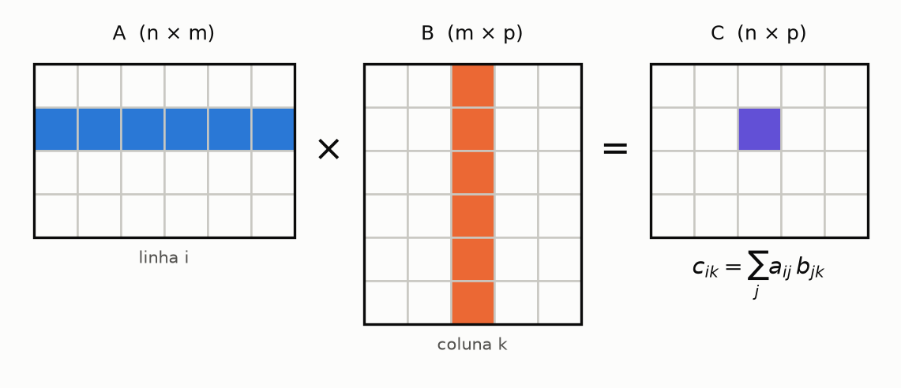

# Multiplicação de Matrizes Paralela

Trabalho final de **Programação Paralela e Distribuída (2026/2) — UFSCar**. O problema vem da Maratona de Programação Paralela (SBAC-PAD) e será resolvido com OpenMP, MPI e GPU, comparando o desempenho de cada versão.

**Integrantes**
- Enzo Dezem Alves — 801743
- Gustavo Cesar Bento Laurindo — 821402
- Gustavo de Oliveira Gimenes — 820759
- Tiago de Paula Evangelista — 824369

## O problema



Multiplicar uma matriz $A$ de dimensão $n \times m$ por uma matriz $B$ de dimensão $m \times p$ gera uma matriz $C$ de dimensão $n \times p$. Cada elemento é calculado por

$$c_{ik} = \sum_j a_{ij} \, b_{jk}$$

ou seja, a linha $i$ de $A$ (azul) é combinada com a coluna $k$ de $B$ (laranja) para gerar o elemento $c_{ik}$ (violeta). São $2nmp$ operações no total. Como nenhum elemento de $C$ depende de outro, todos podem ser calculados ao mesmo tempo, e é isso que as versões paralelas vão explorar.

## Implementação sequencial


A versão sequencial é a referência de tempo e de correção para todas as outras. A fórmula pode ser calculada com os laços em ordens diferentes, e a ordem muda muito o desempenho:

- **`i-k-j` (ingênua):** calcula cada $c_{ik}$ de uma vez, mas para isso desce pela coluna de $B$. Como as matrizes ficam guardadas linha por linha, cada acesso salta $p$ posições na memória e desperdiça o cache.
- **`i-j-k` (usada):** fixa um valor $a_{ij}$ e o multiplica pela linha inteira $B[j]$, acumulando na linha $C[i]$. As duas linhas estão contíguas na memória, o que aproveita o cache e permite que o compilador vetorize o laço.

As duas ordens fazem exatamente as mesmas contas. Usar a versão mais rápida como referência evita *speedups* inflados nas versões paralelas.

## Medição de tempo padronizada

Todas as implementações usam a mesma infraestrutura, para que a comparação seja justa:

- [`src/common.h`](src/common.h) faz a leitura das dimensões, a alocação, a inicialização determinística das matrizes e o *checksum*. O relógio mede apenas o tempo da multiplicação.
- Cada programa é executado como `./prog n m p` (ou `./prog n` para matrizes quadradas) e imprime uma linha no formato `RESULT,<impl>,<n>,<m>,<p>,<workers>,<tempo_s>,<checksum>`.
- No notebook, a função `benchmark()` roda cada programa várias vezes e guarda os resultados em uma tabela única, usada na análise de desempenho.

## Como executar

```bash
python3 -m venv venv
source venv/bin/activate
pip install -r requirements.txt
jupyter lab matrix_multiplication.ipynb
```

Requisitos de sistema: `gcc` com OpenMP, uma implementação MPI (`mpicc`/`mpirun`) e o CUDA Toolkit (`nvcc`) para a versão em GPU. O notebook também pode ser executado no Google Colab.
